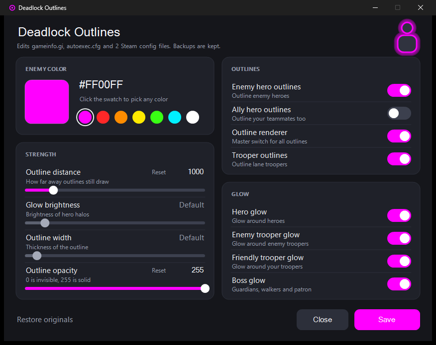

# Deadlock Outlines

[](https://github.com/luccahp1/deadlock-outlines/actions/workflows/build.yml)

A small Windows app for making enemies easier to see in Deadlock. Pick an enemy color, turn outlines and glow on or off, and adjust outline width, distance and glow brightness. It writes the settings straight into the game's config files, so there is no console typing and no hunting through menus.

Built for players with low vision, but anyone who wants stronger outlines can use it.



## Download

Get `DeadlockOutlines.exe` from the [latest release](https://github.com/luccahp1/deadlock-outlines/releases/latest). It is a single 240 KB file with no installer and no dependencies.

## Usage

1. Close Deadlock.
2. Open `DeadlockOutlines.exe`.
3. Pick an enemy color (presets or the full color picker), set the toggles and sliders, then click **Save**.
4. Start the game.

Sliders show **Default** until you move them. **Reset** returns one to the game's default. **Restore originals** puts back every file exactly as it was before the app first saved.

## What it changes

| File | What is written |
| --- | --- |
| `game\citadel\gameinfo.gi` | Outline and glow settings in the `ConVars` block |
| `game\citadel\cfg\autoexec.cfg` | The same settings plus the enemy color, between `// deadlock-outlines start` and `// deadlock-outlines end` |
| `Steam\userdata\<id>\1422450\local\cfg\user_convars*.vcfg` | Enemy color |
| `Steam\userdata\<id>\1422450\remote\user_convars.vcfg` | Enemy color (the Steam Cloud copy) |

The game runs `autoexec.cfg` on every launch, so the settings come back even if Steam Cloud or a mod manager resets the other files. Lines you add to `autoexec.cfg` yourself are left alone.

Before the first save, each file is copied to `<name>.bak`. Those copies are never overwritten, so they always hold your original files.

The Steam folder is read from the registry, and every Steam library in `libraryfolders.vdf` is checked for the game.

## Settings

| In the app | Convar |
| --- | --- |
| Enemy color | `citadel_enemy_ui_color_r/g/b`, `citadel_custom_ui_colors` |
| Enemy hero outlines | `citadel_player_outline_enemies` |
| Ally hero outlines | `citadel_player_outline_allies` |
| Outline renderer | `r_citadel_npr_outlines` |
| Trooper outlines | `citadel_trooper_outline_enabled` |
| Hero glow | `citadel_player_glow_disabled` (inverted) |
| Enemy trooper glow | `citadel_trooper_glow_disabled` (inverted) |
| Friendly trooper glow | `citadel_trooper_friendly_glow_disabled` (inverted) |
| Boss glow | `citadel_boss_glow_disabled` (inverted) |
| Outline distance | `r_citadel_npr_outlines_max_dist` |
| Glow brightness | `cl_glow_brightness` |
| Outline width | `r_citadel_selection_outline2_width` |
| Outline opacity | `r_citadel_selection_outline2_alpha` |

Every convar name was checked against the game's `client.dll`. Valve does not publish the default values, so the slider ranges are a best guess. Raise width or brightness a few steps at a time and check in game.

## Building

Requires Visual Studio 2022 or newer (or the Build Tools) with the C++ desktop workload.

```bat
build.cmd
```

The exe is written to `build\DeadlockOutlines.exe`. The whole app is one file, [`src/main.cpp`](src/main.cpp), using Win32 and GDI+ only.

For testing without touching the game, point it at a folder holding a `gameinfo.gi`, an `autoexec.cfg` and any `.vcfg` files:

```bat
build\DeadlockOutlines.exe --root C:\path\to\test-folder
```

## License

[MIT](LICENSE). Not affiliated with Valve.
